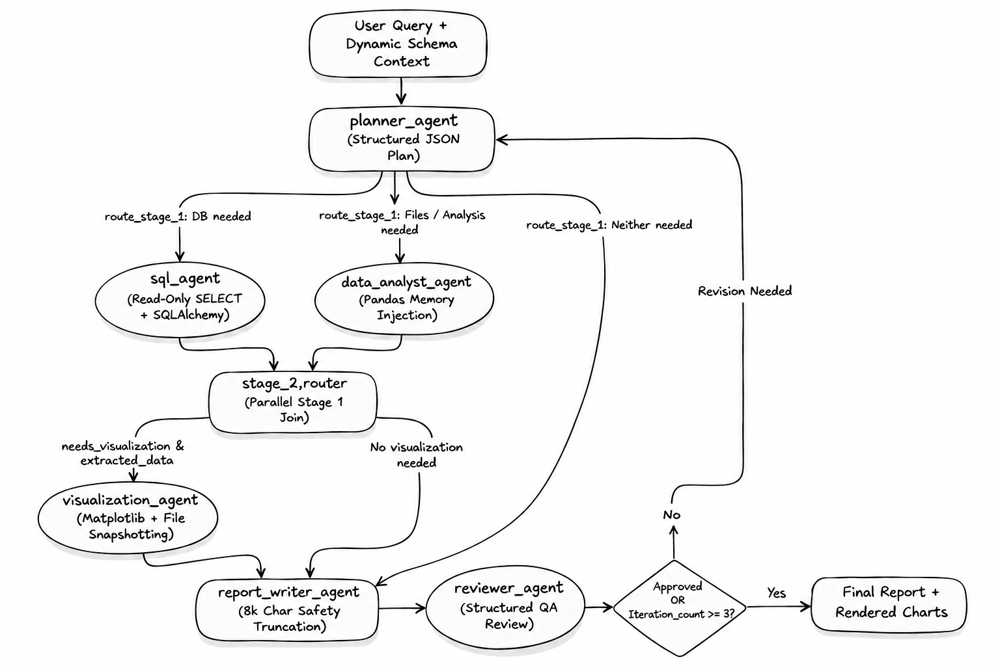

# Autonomous Data Insights Network

A dynamic, multi-agent data analysis platform built with **Python, LangGraph, LangChain (Groq), SQLAlchemy, Pandas, Matplotlib, and Streamlit**.

Upload any CSV or multi-sheet Excel (`.xlsx`) files, connect to a live **MySQL** or **PostgreSQL** database in real time, and ask natural language questions across either or both sources to receive an executive Markdown report with automatically generated charts.

---

## Agent Workflow Diagram



---

## Key Features

- **Dynamic Schema Discovery**: Zero hardcoded datasets or database schemas.
  - **File Connector (`src/data_connector.py`)**: Loads `.csv` files and iterates all sheets of `.xlsx` workbooks (`{filename}_{sheet_name}`), extracting row/column counts, dtypes, and sample rows.
  - **Live DB Inspector (`src/data_connector.py`)**: Connects safely via `sqlalchemy.engine.URL.create()` to MySQL (`mysql+pymysql`) or PostgreSQL (`postgresql+psycopg2`) and inspects tables, column types, primary keys, and foreign keys.
- **2-Stage Parallel LangGraph Pipeline (`src/graph_builder.py`)**:
  - **Stage 1**: `planner_agent` dynamically dispatches `sql_agent`, `data_analyst_agent`, or both in parallel using parallel-safe state reducers (`merge_dicts`, `combine_feedback`, `operator.add`).
  - **Stage 2**: `stage_2_router` joins Stage 1 outputs and routes to `visualization_agent` if charts are needed, then into `report_writer_agent` and `reviewer_agent` with a self-healing retry loop (up to 3 iterations).
- **Production Guardrails (`src/nodes.py`)**:
  - Read-only SQL regex guardrail blocking `DROP`, `DELETE`, `UPDATE`, `INSERT`, `ALTER`, `TRUNCATE`, `GRANT`, and `REVOKE`.
  - Memory injection (`exec()`) for Pandas analysis and Matplotlib chart generation without stringifying full datasets into LLM prompts.
  - File-system snapshotting on `temp_charts/` to detect newly generated PNG charts.
  - 8,000-character truncation safety valve in `report_writer_agent`.

---

## Setup & Usage

1. **Create and activate a virtual environment**:
   ```bash
   python -m venv venv
   # Windows PowerShell:
   .\venv\Scripts\Activate.ps1
   # macOS / Linux:
   source venv/bin/activate
   ```

2. **Install dependencies**:
   ```bash
   pip install -r requirements.txt
   ```

3. **Configure environment variables**:
   Edit `.env` (must be UTF-8 encoded without BOM) and set your Groq API key:
   ```env
   GROQ_API_KEY=your_groq_api_key_here
   ```

4. **Launch the Streamlit app**:
   ```bash
   python -m streamlit run src/app.py
   ```
